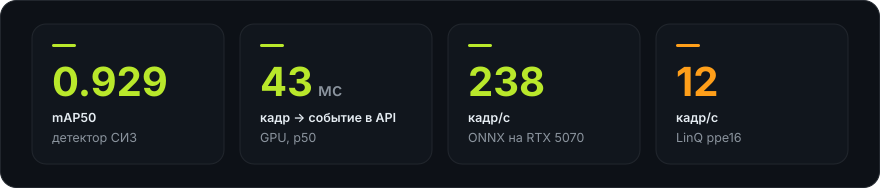
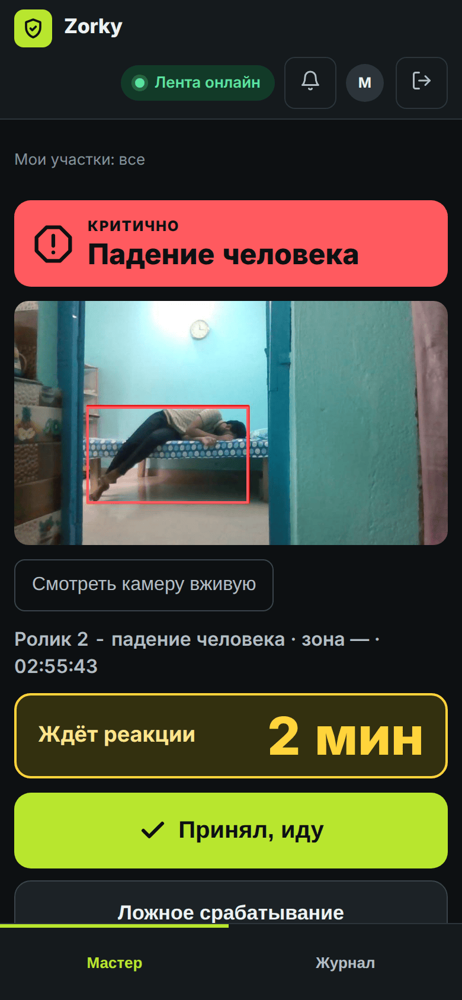
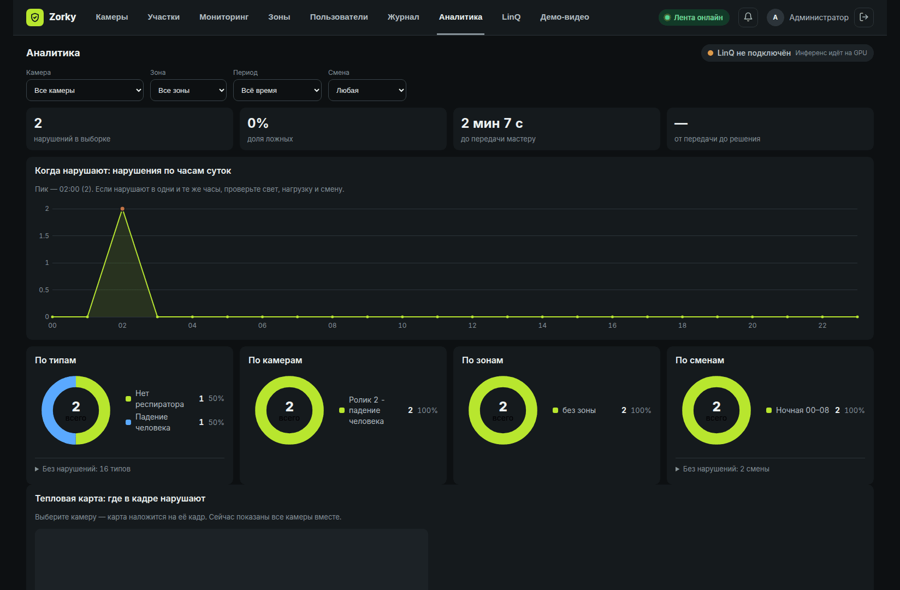
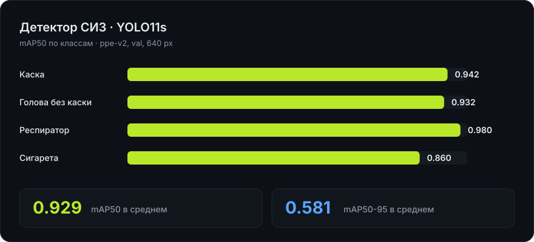
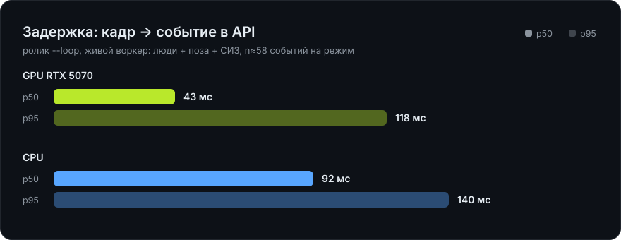
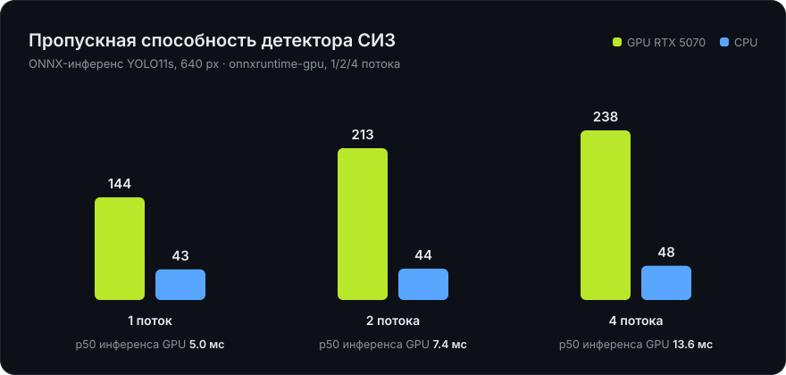
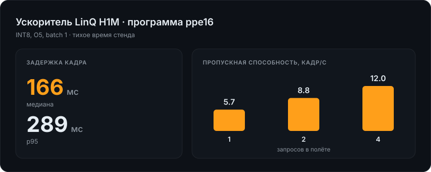
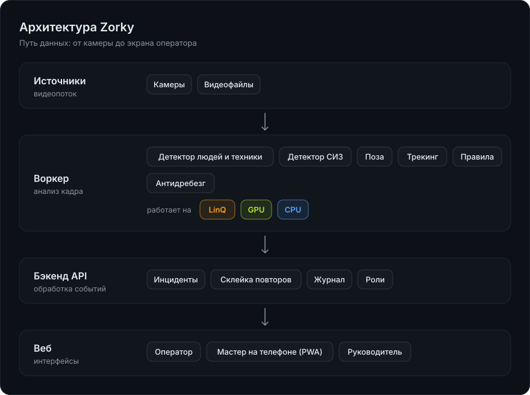

<div align="center">

# Zorky

**Видеоконтроль промышленной безопасности.**<br>
Камера видит нарушение — ответственный получает карточку с кадром за секунды. Одно нарушение — одно оповещение.



<br>


</div>

<br>

> **Что лежит в репозитории.** Веса детектора — [`models/best.onnx`](models/) (YOLO11s, SHA256 `477b5c4d…`). Два демо-ролика — [`demo/clips/`](demo/clips/): «без происшествий» и «падение человека». Руководство пользователя — [`docs/Zorky_user_guide.pdf`](docs/Zorky_user_guide.pdf). Ничего докачивать не нужно.

## Что это

Zorky разбирает видеопотоки с камер и находит опасное поведение: человек без каски или респиратора, курение, падение, вход в запретную зону. Нейросеть работает на отечественном ускорителе **LinQ**, на видеокарте или на процессоре. Видео и журнал остаются внутри контура предприятия — облачных сервисов нет.

|  |  |
|---|---|
| **Одно нарушение — одно оповещение** | Пока человек в кадре, растёт счётчик «×N» на одной карточке. Дубликатов нет. |
| **Критичное идёт само** | Падение и неподвижность уходят мастеру без оператора. Эскалация, если он молчит. |
| **Мастер в кармане** | Карточка с кадром на телефоне, таймер реакции, «Принял, иду». Без магазина приложений. |
| **Зоны на кадре** | Полигон рисуется кликами прямо по картинке, правила — по участкам, камерам и расписанию. |
| **Доказательная база** | Журнал с фильтрами, выгрузка в CSV и акт о нарушении в PDF. |
| **Аналитика** | Часы, смены, камеры, зоны, время реакции и тепловая карта на кадре. |

<br>

## Для каждой роли

**Оператор** разбирает очередь «Требуют решения»: кадр с выделенным человеком, три действия, горячие клавиши (`J`/`K`, `1`, `3`), пять причин ложного срабатывания.

<p align="center"></p>

**Мастер** открывает страницу `/master` на телефоне: красный баннер для критичного случая, кадр, таймер реакции, звук и вибрация, кнопка «Принял, иду». Приложение ставится на главный экран, магазин приложений не нужен.

<p align="center"></p>

**Специалист по охране труда** настраивает правила участка и камеры, расписание и зоны без программистов. **Руководитель и аудитор** получают журнал и аналитику только на чтение. **Администратор** управляет пользователями, камерами и устройством инференса.

<p align="center"></p>

<br>

## Цифры

Всё измерено на этом репозитории. Источник — [`docs/measured.json`](docs/measured.json).









<br>

## Архитектура



Слои бэкенда: `domain` → `application` → `infrastructure` → `api`. Зависимости направлены внутрь. Данные между зонами описывает контракт в [`contracts/`](contracts/): JSON-схема события и OpenAPI. Новый тип нарушения — это отдельный модуль-правило в `ml/worker/rules/`, остальная система не меняется.

```
backend/     API, склейка повторов, журнал, роли (FastAPI, SQLite)
ml/          воркер: детекторы, трекинг, правила; обучение и оценка
web/         интерфейс оператора, мастера, руководителя (React, PWA)
linq/        подключение и замеры на ускорителе LinQ
contracts/   схема события и OpenAPI — единственный источник правды
models/      веса детектора СИЗ (best.onnx)
demo/        два демо-ролика (demo/clips) и скрипты демо
docs/        руководство, архитектура, графики
scripts/     лаунчеры под Windows
tests/       сквозные проверки
```

<br>

## Запуск за минуту

Нужны Python 3.12+, Node 20+ и видеокарта NVIDIA (или процессор).

**Модель и ролики** уже в репозитории: `models/best.onnx` и `demo/clips/`. Ролики: Mixkit (лицензия Mixkit) и набор GMDCSA-24 (CC BY 4.0). Демо само положит их в `~/.mosprom/demo-videos/`.

```bash
python3 tasks.py setup          # окружения и зависимости
python3 tasks.py demo --login   # демо: бэкенд + веб, вход одним кликом
```

Откройте `http://localhost:5173` → **«Демо-режим — без пароля»** → роль **Администратор** → вкладка **«Демо-видео»** → «Пустить по кругу» у обоих роликов. Через минуту на мониторинге появятся нарушения. На Windows — двойной клик по `scripts/demo.bat`.

Рабочая система с реальными камерами и Docker: `python3 tasks.py run --from-backend`. Подключение к LinQ: [`docs/LINQ_SETUP.md`](docs/LINQ_SETUP.md). Руководство пользователя по ролям: [`docs/Zorky_user_guide.pdf`](docs/Zorky_user_guide.pdf).

<br>

<div align="center">

**Zorky** · один человек в кадре — одно нарушение — одно оповещение

</div>
